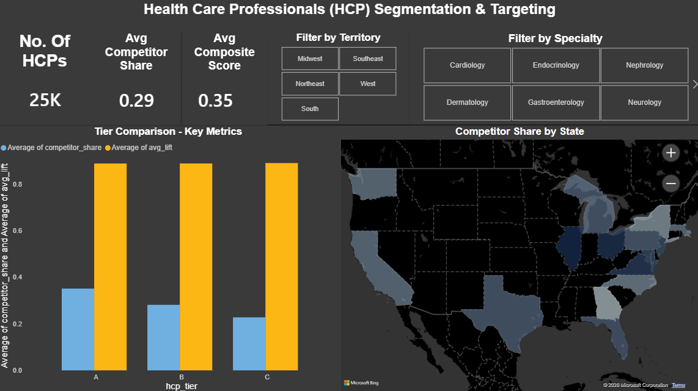
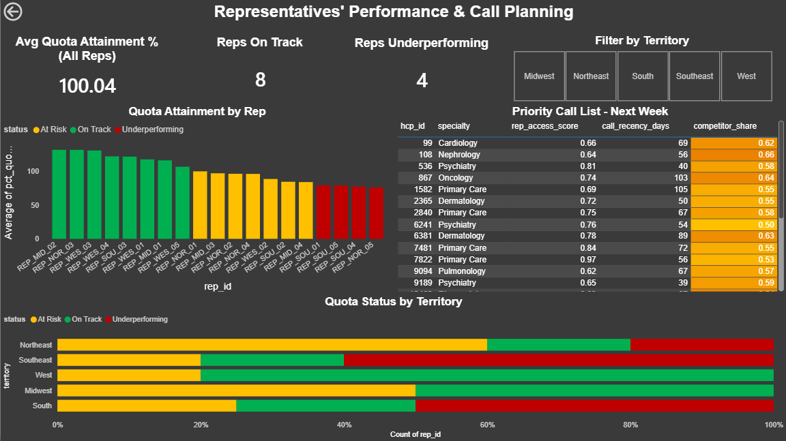
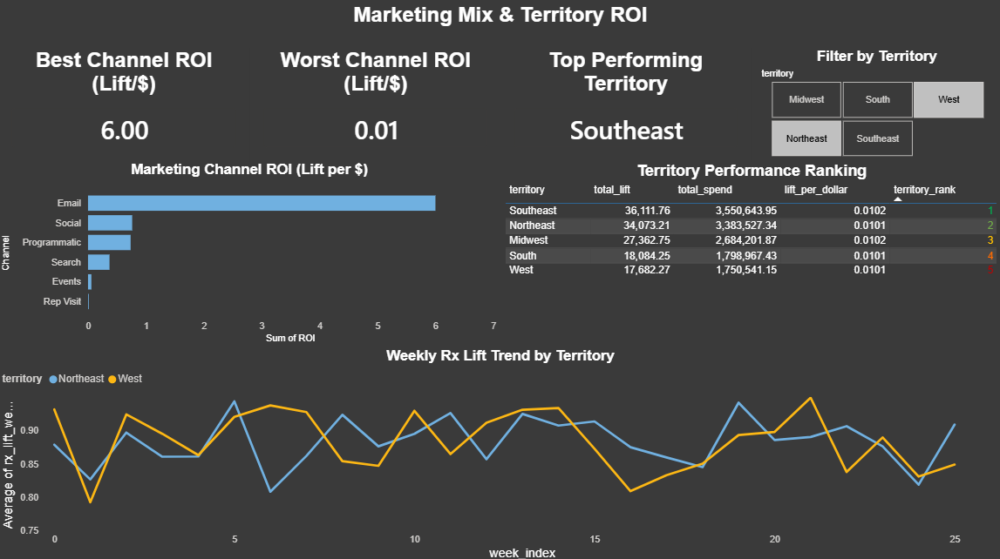

# Pharma Commercial Analytics - HCP Targeting & Sales Force Effectiveness

Pharma commercial analytics system built on a 150K-row synthetic HCP marketing dataset. MySQL for territory segmentation, quota tracking, and call planning queries. Power BI dashboard covering HCP tiering, rep performance, and multi-channel marketing ROI. Python used for data modelling and pipeline automation.

---

## Project Objective

A pharmaceutical company runs a multi-channel marketing campaign targeting ~25,000 doctors (HCPs) across the US over 26 weeks, spending ~$88 per doctor per week. This project answers four core business questions:

1. **Which doctors are worth targeting?** - A/B/C tiering using composite scoring
2. **Are reps hitting their numbers?** - Quota attainment tracking by rep and territory
3. **Which marketing channel gives the best ROI?** - Lift per dollar across 6 channels
4. **Who should reps call next week?** - Priority call list based on access, recency, and competitor share

---

## Tech Stack

| Layer | Technology |
|---|---|
| Data Pipeline | Python (Pandas, NumPy) |
| Database | MySQL 8.0 |
| Analytics | SQL (CTEs, Window Functions, Aggregations) |
| Visualisation | Power BI Desktop + DAX |
| Version Control | Git / GitHub |

---

## Dataset

**Source:** Synthetic HCP Omnichannel Marketing Dataset (Kaggle - danielmeiser)
**Size:** 150,000 rows × 42 columns
**Structure:** Panel data - 150,000 HCP-week observations covering 24,935 unique doctors over a 26-week window (unbalanced panel, ~6 weeks per doctor on average)

**Key column groups:**

- **HCP Profile** - `specialty`, `state`, `panel_size`, `baseline_rx_monthly`, `competitor_share`
- **Scoring** - `rep_access_score`, `digital_affinity_score`, `payer_restriction_score`
- **Marketing Activity** - `rep_calls`, `email_sends`, `email_opens`, `site_visits`, `programmatic_impressions`
- **Channel Costs** - `cost_rep`, `cost_email`, `cost_programmatic`, `cost_search`, `cost_social`, `cost_events`
- **Outcomes** - `rx_lift_weekly`, `response_flag`, `response_probability`, `engagement_score`
- **Engineered** - `territory`, `rep_id`, `weekly_quota_rx_lift` (added via Python)

---

## Repository Structure

```
Pharma-Commercial-Analytics/
│
├── Dashboard_Screenshots/
│   ├── 01_HCP_Segmentation.png
│   ├── 02_Rep_Performance.png
│   └── 03_Marketing_Mix_And_Territory_ROI.png
│
├── 02_create_views.sql               # 5 analytical SQL views
├── addSQL.py                         # Loads CSV into MySQL
├── Pharma_Commercial_Analytics.pbix  # Power BI dashboard file
└── README.md
```

---

## SQL Analytical Views

Five views built on top of the `hcp_marketing` table:

### 1. `vw_hcp_tiering` - HCP Segmentation
Tiers all 24,935 doctors into A/B/C using a composite score:

```
Composite Score = (norm(baseline_rx_monthly) × 0.3)
                + (norm(rep_access_score)    × 0.3)
                + (norm(competitor_share)    × 0.2)
                + (norm(panel_size)          × 0.2)

where norm(x) = (x − MIN(x)) / (MAX(x) − MIN(x))
```

Each input is min-max normalized to a 0–1 scale before weighting, so the 0.3/0.3/0.2/0.2 weights reflect each variable's true contribution to the score rather than being distorted by differences in raw scale (e.g. `panel_size` ranging into the thousands vs. `rep_access_score` bounded at 0–1). Uses `NTILE(3)` window function to split into equal thirds. Tier A = highest composite score = highest priority target.

### 2. `vw_quota_attainment` - Rep Performance
Computes `AVG(rx_lift_weekly) / AVG(weekly_quota_rx_lift) × 100` per rep per territory. Labels reps as **On Track** (≥100%), **At Risk** (80–99%), or **Underperforming** (<80%) using `CASE WHEN`.

### 3. `vw_channel_roi` - Marketing Mix ROI
Computes `SUM(rx_lift_weekly) / SUM(cost_X)` for each of 6 marketing channels.
Key finding: email generates **6.0 Rx lift per dollar** vs **0.013 for rep visits** - a 460× efficiency gap.

### 4. `vw_priority_call_list` - Next Week Call Targets
Filters the latest week's snapshot for HCPs meeting all four criteria:
- `rep_access_score > 0.6` - accessible
- `call_recency_days > 30` - not recently visited
- `response_flag = 1` - historically responded
- `competitor_share > 0.5` - competitor-dominated, high opportunity

### 5. `vw_territory_ranking` - Territory Performance
Ranks all 5 territories by total Rx lift generated using the `RANK()` window function. Southeast ranks #1 with 36,111 total lift units.

---

## Power BI Dashboard

### Page 1 - HCP Segmentation & Targeting



- **Clustered bar chart** - competitor share and avg Rx lift by HCP tier (A/B/C), showing Tier A carries the highest competitor penetration - the primary targeting rationale
- **Filled map** - average competitor share by US state using a blue gradient; darker = stronger competitor presence = higher market opportunity
- **KPI cards** - Total HCPs (25K), Avg Competitor Share (0.29), Avg Composite Score (0.35)
- **Slicers** - Filter by territory and specialty; cross-filter all visuals simultaneously

---

### Page 2 - Representatives' Performance & Call Planning



- **Column chart** - quota attainment % per rep, colour-coded green/amber/red (On Track / At Risk / Underperforming); all 19 reps visible in one view
- **Priority call list table** - 23 high-opportunity HCPs filtered from latest week, with competitor share heat map (amber -> red) highlighting most urgent targets
- **100% stacked bar** - proportion of reps by quota status across all 5 territories; West is the strongest, South and Southeast have highest Underperforming share
- **KPI cards** - Avg Quota Attainment % (100.04), Reps On Track (8), Reps Underperforming (4)
- **Slicer** - Filter by territory; cross-filters all visuals on the page

---

### Page 3 - Marketing Mix & Territory ROI



- **Horizontal bar chart** - channel ROI ranking across 6 channels; Email (6.00 lift/$) far outperforms Rep Visit (0.01 lift/$) - a 460× gap
- **Territory ranking table** - all 5 territories ranked 1-5 by total Rx lift with colour-coded rank numbers (green = top, red = bottom)
- **Line chart** - weekly Rx lift trend per territory over 26 weeks; interactive territory slicer highlights selected territory while others fade
- **KPI cards** - Best Channel ROI (6.00), Worst Channel ROI (0.01), Top Performing Territory (Southeast)
- **Slicer** - Filter by territory; filters line chart while leaving ranking table unaffected

---

## Key Insights

- **Email generates 460× better ROI than rep visits** on a cost-per-lift basis ($0.17 vs $77 per Rx lift unit) - though rep visits serve a relationship-building function not captured in short-term lift metrics alone
- **Southeast is the top-performing territory** with 36,111 total Rx lift units; West ranks last at 17,682
- **4 of 19 reps are Underperforming** (below 80% quota attainment), concentrated in the Northeast and Southeast territories
- **Midwest/Ohio area shows highest competitor penetration** on the geographic map - the strongest opportunity for market share recovery
- **Tier A doctors carry higher competitor share** (0.33 avg) than Tier C (0.23 avg), confirming that the targeting model correctly prioritises competitor-dominated HCPs - not just high prescribers
- **Tiering separates HCPs cleanly on competitor share (the intended targeting signal) but does not differentiate on realized Rx lift** - consistent with the model prioritising opportunity over historical response

---

## How to Run

**1. Load into MySQL:**
```bash
pip install sqlalchemy pymysql pandas
python addSQL.py
```

**2. Create analytical views:**
```sql
source 02_create_views.sql
```

**3. Open dashboard:**
Open `Pharma_Commercial_Analytics.pbix` in Power BI Desktop. Update the MySQL connection to `127.0.0.1:3306` with your credentials under Transform Data → Data Source Settings.

---

## Skills Demonstrated

`MySQL` · `SQL Window Functions (NTILE, RANK)` · `CTEs` · `Python (Pandas, NumPy)` · `Power BI` · `DAX Measures` · `Data Modelling` · `Pharma Commercial Analytics` · `Sales Force Effectiveness (SFE)` · `HCP Targeting`